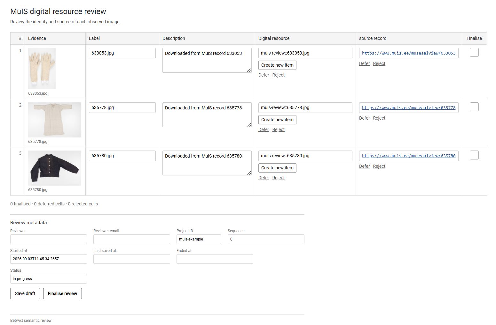
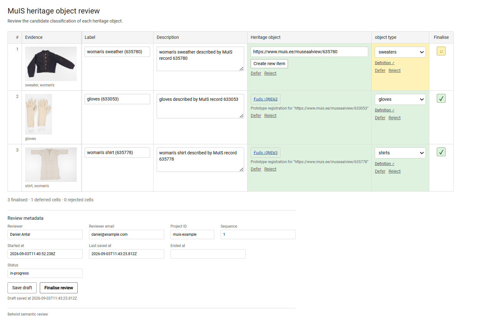

```{r, include = FALSE}
knitr::opts_chunk$set(
  collapse = TRUE,
  comment = "#>"
)
```

## From observation to review

`fscontext` uses PROV- and RiC-O-oriented heuristics to reconstruct filesystem contents, whether born-digital resources or digital surrogates, into structures suitable for modern, standards-based archival description. These default heuristics make it possible to generate candidate contextual and provenance assertions efficiently, but they do not substitute for data stewardship. The resulting interpretations may still require correction, qualification, or confirmation by a human reviewer.

Betwixt is named for the intermediate position it occupies in this process. It provides intermediate relational representations between automatically generated candidate assertions and their subsequent use as stabilised semantic knowledge. These representations allow the results of `fscontext` heuristics to be inspected and reproducibly revised without making either the filesystem representation or the review table itself the canonical knowledge representation.

`fscontext` deliberately separates observation from interpretation. A filesystem scan records what was observed in a storage context without determining the documentary or semantic identity of those resources. Structural and contextual information derived from those observations may then support later interpretation and semantic stabilisation.

This vignette demonstrates the next step in that workflow. It uses Betwixt to turn observational evidence and candidate assertions produced with `fscontext` into bounded human-review tasks.

```{r setup}
library(fscontext)
library(dplyr)
library(fscontext)
library(tibble)
```

## From digital surrogates to heritage claims

A common cultural-heritage workflow begins not with an existing knowledge graph but with digital resources retrieved from a collection catalogue or repository. The following example uses three object records from the Estonian museum portal MuIS. Each catalogue page provides a thumbnail depicting a heritage object.

The review examples use the development version of [Betwixt](https://betwixt.dataobservatory.eu/). The Betwixt-dependent code is not evaluated when the `fscontext` vignette is built.

```{r}
#| label: install-betwixt
#| eval: false
# install.packages("pak")
pak::pak("dataobservatory-eu/betwixt")
```

```{r}
#| label: muis-input
#| eval: false
review_input <- tibble::tribble(
  ~page_id, ~title, ~page_url, ~thumbnail_url, ~value,
  "635780", "sweater, women's",
  "https://www.muis.ee/museaalview/635780",
  "https://www.muis.ee/digitaalhoidla/api/meedia/pisipilt?id=ebc07930-f719-44f2-a108-6698bcecc20b",
  "sweaters",
  "633053", "gloves",
  "https://www.muis.ee/museaalview/633053",
  "https://www.muis.ee/digitaalhoidla/api/meedia/pisipilt?id=6440f24f-eaad-4cd4-84d7-1ae7a9d44d5a",
  "gloves",
  "635778", "shirt, women's",
  "https://www.muis.ee/museaalview/635778",
  "https://www.muis.ee/digitaalhoidla/api/meedia/pisipilt?id=826c402e-c130-4860-b11e-9538bd403ecf",
  "shirts"
)
```

The catalogue URLs identify the source records, but the images used as evidence are separate digital resources. We first download those resources into a temporary filesystem context.

```{r}
#| label: muis-download
#| eval: false

image_dir <- file.path(tempdir(), "muis-images")
dir.create(image_dir, showWarnings = FALSE)

download_map <- tibble::tibble(
  thumbnail_url = review_input$thumbnail_url,
  filename = paste0(review_input$page_id, ".jpg"),
  local_path = file.path(
    image_dir,
    paste0(review_input$page_id, ".jpg")
  )
)

for (i in seq_along(download_map$thumbnail_url)) {
  download.file(
    url = download_map$thumbnail_url[i],
    destfile = download_map$local_path[i],
    mode = "wb",
    quiet = TRUE
  )
}

download_map
```

`fscontext` can now observe the downloaded resources as filesystem evidence. The observation records their location within the storage context and, with signature computation enabled, a lightweight content signature. These are observational identifiers: they establish which file was observed in this review workspace without asserting that the local file is the canonical identity of the heritage object or of every possible copy of the image. :contentReference[oaicite:1]{index="1"}

```{r}
#| label: muis-fscontext
#| eval: false

images <- fscontext::scan_storage(
  root = image_dir,
  storage_id = "muis-review",
  person_id = "reviewer",
  compute_signature = TRUE
)

images |>
  select(
    filename,
    storage_path_id,
    quick_sig
  )
```

The filesystem observations can be connected back to the MuIS records from which the images were obtained.

```{r}
#| label: muis-connect-source
#| eval: false

image_evidence <- images |>
  left_join(
    download_map,
    by = "filename"
  ) |>
  left_join(
    review_input |>
      select(
        page_id,
        title,
        page_url,
        thumbnail_url
      ),
    by = "thumbnail_url"
  )
```

This produces two distinct identities that should not be conflated: the observed digital resource identified in the filesystem context and the museum catalogue record identified by its MuIS URL. Their relationship is itself semantic material that can be reviewed.

## Reviewing the digital resources

The first Betwixt projection reviews the relationship between the locally observed image and its source record.

```{r}
#| label: muis-resource-candidates
#| eval: false

resource_review <- betwixt::candidate_dataset(
  evidence_url = image_evidence$thumbnail_url,
  evidence_text = image_evidence$filename,
  label = image_evidence$filename,
  description = paste(
    "Downloaded from MuIS record",
    image_evidence$page_id
  ),
  subject = image_evidence$storage_path_id
) |>
  betwixt::add_candidate_column(
    value = image_evidence$page_url,
    definition = rep(
      "derived from source record",
      nrow(image_evidence)
    )
  )

resource_review 
```

```{r}
#| label: render-muis-resource-review
#| eval: false

betwixt::betwixt_render(
  resource_review,
  cols = c(
    col_1 = "Digital resource",
    col_2 = "source record"
  ),
  title = "MuIS digital resource review",
  description = "Review the identity and source of each observed image.",
  project_id = "muis-example",
  filename_stem = "muis-resource-review",
  sequence = 0L,
  path = tempdir()
)

betwixt_review_1 <- readLines(
  con = file.path(tempdir(), "muis-resource-review.html")
)
  
```

```{r}
#| label: serialise-muis-resource-review
#| eval: false
writeLines(
  text = betwixt_review_1,
  con = file.path(here::here(), 
                  "vignettes", "artefacts",  
                  "muis-resource-review.html")
)
```

This review concerns the identity and source relationship of the observed evidence itself. It does not yet assert what the image depicts.



You can fill out the intermediate format, and save it as a draft, or as a finalised, reviewed object. You can complete the review and save the standalone HTML as a draft or as a finalised review. The saved artefact retains the observational evidence supplied from `fscontext`, the candidate semantic material presented for review, and the resulting human review state and review metadata.

You can try it out by downloading the rendered example from [here](https://downloads.reprex.nl/betwixt/artefacts/muis-resource-review.html).

For a tutorial on how to use Betwixt, read [Review Layouts](https://betwixt.dataobservatory.eu/articles/layout.html).

## Reviewing the heritage objects

A second projection uses the same evidence to review candidate knowledge about the heritage objects.

```{r}
#| label: muis-object-candidates
#| eval: false

object_review <- betwixt::candidate_dataset(
  evidence_url = review_input$thumbnail_url,
  evidence_text = review_input$title,
  label = review_input$title,
  description = paste(
    "Heritage object described by MuIS record",
    review_input$page_id
  ),
  subject = review_input$page_url
) |>
  betwixt::add_candidate_column(
    value = review_input$value,
    range = candidate_range(
      "sweaters",
      "gloves",
      "shirts",
      "Other…"
    ),
    definition = rep(
      "object type",
      nrow(review_input)
    )
  )
```

```{r}
#| label: render-muis-object-review
#| eval: false

betwixt::betwixt_render(
  object_review,
  cols = c(
    col_1 = "Heritage object",
    col_2 = "object type"
  ),
  title = "MuIS heritage object review",
  description = "Review the candidate classification of each heritage object.",
  project_id = "muis-example",
  filename_stem = "muis-object-review",
  sequence = 0L,
  path = tempdir()
)

betwixt_review_2 <- readLines(
  con = file.path(tempdir(), "muis-object-review.html")
)
```

The two reviews deliberately separate two questions. The first asks which digital resource was observed and from which museum record it was obtained. The second asks what can be asserted about the heritage object on the basis of that evidence.

```{r}
#| label: serialise-muis-object-review
#| eval: false
writeLines(
  text = betwixt_review_2,
  con = file.path(here::here(), 
                  "vignettes", "artefacts",  "muis-object-review.html")
)
```



You can try out the second review by downloading the not yet reviewed version of the rendered html file from [here](https://downloads.reprex.nl/betwixt/artefacts/muis-object-review.html).

## From two reviews to a dual projection

Once both relationships have been sufficiently established, they can be joined into the dual representation developed earlier in this paper:

$$(\text{digital resource},\texttt{depicts},\text{heritage object})
\bowtie
(\text{heritage object},\texttt{object type},\text{candidate class}).$$

In wide form this would have the structure:

| Evidence       | Relation  | Subject            | object type |
|----------------|-----------|--------------------|-------------|
| observed image | `depicts` | MuIS object 635780 | sweaters    |
| observed image | `depicts` | MuIS object 633053 | gloves      |
| observed image | `depicts` | MuIS object 635778 | shirts      |

The example deliberately performs these as two separate reviews before combining their results. The identity and source of the digital evidence can therefore be reviewed independently from the classification of the heritage object. Once sufficiently stabilised, the reviewed relationships can provide the inputs to a subsequent dual projection.

Betwixt can also represent the evidence relation directly in a dual-wide review. Here the two stages are kept separate to demonstrate how an `fscontext` observation can first become reviewed evidence and only subsequently participate in a further semantic review.

The example also illustrates the complementary roles of `fscontext` and Betwixt. `fscontext` observes and identifies the digital resources encountered in a filesystem context without prematurely identifying them with the heritage objects they depict, while Betwixt turns the resulting candidate relationships into bounded human-review tasks. The semantic connection between digital evidence and heritage knowledge is therefore made explicit rather than being hidden in the mechanics of downloading or displaying an image.

## Relationship to the fscontext workflow

The example extends the observational workflow developed in the preceding `fscontext` vignettes. `scan_storage()` records the digital resources encountered in a storage context. Structural and contextual operations can organise those observations without treating the resulting structures as authoritative documentary knowledge. Betwixt provides a downstream mechanism for exposing candidate interpretations to human review.

The two packages therefore operate at different stages of the same workflow:

```text
digital resources
        ↓
fscontext observation
        ↓
contextual organisation
        ↓
candidate semantic relationships
        ↓
Betwixt human review
        ↓
reviewed semantic material
